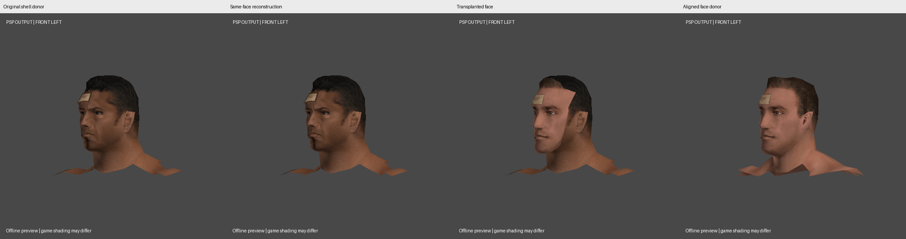
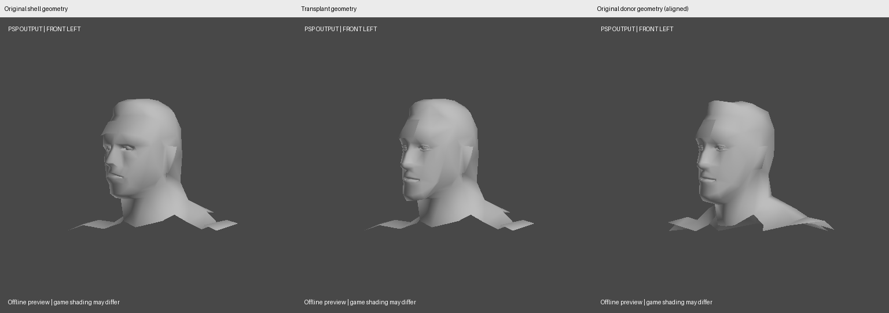

# Modular native PSP facial geometry: isolated feasibility study

Scope: **experimental CLI prototype**, branch `experiment/modular-facial-geometry`.
The released Creator 0.3, independent converter, texture viewer, roster tools,
library donors, and accepted PACs are unchanged. No face controls have been added
to the application. This study is not an in-game acceptance result.

`CONFIRMED` means reproduced by binary inspection or the checks described below;
`INFERRED` identifies an interpretation/design recommendation;
`UNKNOWN` identifies untested runtime behavior or an unresolved capability.

## Findings and answers to the eight initial questions

| Question | Finding and evidence status |
|---|---|
| Can central faces be identified and separated? | **CONFIRMED:** the Batista/Chris Masters trial produces a central skin patch and the surrounding shell using existing triangle edges. Eye/teeth resources are separate attachments. **INFERRED:** material-name and bone-landmark hints are a useful seed, not a reliable semantic classifier. |
| Continuous head or separate submesh? | **CONFIRMED:** neither tested face is one detachable submesh. Batista's native face material spans eight buffers; Masters' spans eight different buffers. Geometric edges join across buffer/material/UV boundaries. The same face image also covers surrounding head geometry. |
| Can cutting/reassembly preserve skeleton data? | **CONFIRMED:** extraction followed by SAME-face reconstruction preserves every oriented triangle's position, normal, UV, color, named nonzero weights, material behavior bytes, and texture bytes. All 80-byte bone records remain byte-exact. Native layout/strip grouping and resulting PAC bytes change. |
| How different are topology and UVs? | **CONFIRMED:** Batista has 383 native face-skin triangles; Masters has 404. The chosen final patches have 21 vs 16 outer contour vertices and native inner openings with 6/6 vs 4/4 corners. Both use 128×128/16-entry face images, but their images, UV records, controller binds and vertex layouts differ. The inventory records per-buffer counts, UV bounds, strides, palettes and influences. No cross-donor vertex-order/UV correspondence is assumed. |
| Can fitting preserve distinctive geometry? | **CONFIRMED:** the final trial uses only eye-midpoint translation for the donor interior; no scaling, nonuniform deformation, decimation or surface projection. Only attachment-ring records move. A uniform-gray comparison shows an actual change in the nose/chin/jaw surface. **INFERRED:** the result retains recognizable donor features; likeness still requires human judgment. |
| Does PAC/YOBJ prevent cutting/welding? | **CONFIRMED:** the existing writer can encode the new buffers, indices, palettes and relocations; the resulting PAC passes strict readback. Eight-slot palettes, float-skinned layout, index bounds and retained rendering metadata remain enforced. **UNKNOWN:** arbitrary additional buffers/controller combinations in real SVR clips; valid serialization does not establish runtime safety. |
| Best attachment method? | **INFERRED:** reviewed native-topology contours, a common boundary sampling, and a limited fitting collar are the simplest useful starting point. Position-only welding is unsafe. A standardized library of APPROVED contours is preferable to one universal cut plane. The current collar is only C0-continuous; automatic skin-tone blending and higher-order shading continuity are unfinished. |
| Can the whole library be automated? | **CONFIRMED:** of 31 native donors, 18 pass the first boundary extraction rule; 11 also pass its first polar fit-chart check. These are boundary checks, NOT 11 validated transplants. **INFERRED:** library automation will need reviewed per-donor material/contour profiles and rejection paths. **UNKNOWN:** reliable fully automatic extraction/transplantation across all 31, additional facial skeletons, and imported non-native faces. |

See [the raw library inventory](creator-facial-poc-library.json) and
[the complete successful trial report](creator-facial-poc-result.json).
The [research bundle](creator-facial-poc/PSP-Modular-Face-POC-01.zip) contains
both PACs, native/OBJ/texture exports, comparison renders, instructions and
verification logs. Its [SHA-256 file](creator-facial-poc/PSP-Modular-Face-POC-01.zip.sha256)
and internal per-file manifest permit independent download verification.
The approximate white-outline image mentioned in the request was not included
with the text attachment. This prototype's contour is a topology demonstration,
not a claim to match that missing drawing precisely.

## Experiments A–D and measured results

**CONFIRMED:** source PAC hashes:

- Batista: `d73e8d53df28b88d51d13ce608bf6d96fc837e8eb3b977fe6d11dbfc43e23288`
- Chris Masters: `cc6111731cdebb0c51c0df9e37b3f779ada2d09a263238c787d81ce3ee8b7c4b`

| Whole-model result | Mesh buffers | Vertex records | Triangles | PAC bytes |
|---|---:|---:|---:|---:|
| Original Batista shell donor | 26 | 1,514 | 1,497 | 112,640 |
| Same-face reconstruction | 52 | 1,514 | 1,497 | 114,688 |
| Original Masters face donor | 25 | 1,352 | 1,499 | see original library catalog |
| Batista shell + Masters facial geometry | 52 | 1,515 | 1,535 | 118,784 |

**CONFIRMED:** the temporary serializer keeps source material slices separate,
which explains 52 buffers even in the exact reconstruction. It has not applied a
lossless recombination optimization. Neither 31 nor any other arbitrary count is
treated as a format requirement. This extra fragmentation and its runtime impact
must be reviewed before production integration.

**CONFIRMED — A, extraction:** the output includes separate native YOBJ/OBJ/MTL/PNG
previews of Batista's head shell and facial insert. These intentionally open
parts are research geometry, not individually playable wrestler PACs.

**CONFIRMED — B, original reconstruction:** source attributes and materials are
compared as oriented triangle multisets, independent of rewritten index order.
The reconstruction actually combines the extracted sets and passes the writer;
it does not return the source binary as a shortcut. All 30 analytical probes
match the original exactly, and all bone-table records remain identical.

**CONFIRMED — C, cross-donor transplantation:** the final profiles use native
negative-Z front-depth seeds `-1.0` for the shell and `-0.9` for the insert.
These seed whole-triangle ownership, not a planar triangle cut. A generic bounded
topological-ear rule leaves two all-boundary forehead cap triangles out of the
donor insert; their identities are recorded, not hardcoded. The original donor
PAC is never edited. This avoids folding those caps onto a different forehead.

**CONFIRMED:** interior fit is translation
`[0.000107073270, -0.250011691, -0.0613458325]` in native model units, derived
from the two eye bone origins. Source positions/UVs/normals/colors/nonzero weights
are verified on 1,457 unchanged output records. Maximum static source-position
difference is only float32 serialization roundoff (see report). The attachment
ring's maximum move is `0.391037` native units; this is a measured displacement,
not an acceptable universal tolerance or a manual anatomical sculpt.

**CONFIRMED:** 278 unique retained donor facial-skin records have mean nearest
distance `0.033545`, p95 `0.105180`, maximum `0.173672` from the original Batista
facial surface. This topology-independent comparison demonstrates nonzero 3D
geometry changes. It is not a recognition/identity metric.

**CONFIRMED:** 37 final attachment edges are each present twice with opposite
winding. There are no detected ordinary degenerate or duplicate geometric faces.
Every output triangle faces within 90° of its source triangle's normal; minimum
source-normal dot is `0.391083`. These checks do not prove freedom from all global
self-intersections.

**CONFIRMED — D, PSP export:** native buffer/range/palette/weight/POF0 audits pass;
section starts are 16-byte aligned, final size is 2048-byte aligned. Texture GIMs
remain byte-exact. The unchanged section 8 stored payload is byte-identical.
The PAC's decompressed YOBJ equals the supplied preview YOBJ. No texture fitting,
geometry reduction, donor-file edits or packaging-code changes were used.

| Experimental output | SHA-256 |
|---|---|
| Reconstructed original | `dfd1ce6722568d6570126a9b696f82d43abed2a008a27de368d1e8e58e6ebb33` |
| Shell with donor face | `ce48613f6708cfb9491c5f62d9a6c108d86de4ff826ed53a5d02a458a9e457c9` |

## Rigging and animation evidence

**CONFIRMED:** the tested pair has the same 79 named bones and compatible parent
names. The prototype rejects missing/extra names, incompatible parentage,
incompatible native controller rotations, and unsupported multi-descriptor input.
It does not collapse missing controllers to ancestors or assume another pair has
this same skeleton.

**CONFIRMED:** named donor facial controller world binds are translated with the
insert and expressed relative to the shell hierarchy. The shell head, neck and
body bind transforms remain unchanged. Its original opaque bone fields remain;
observed culling-radius fields are conservatively expanded, not shrunk. Their
full game-side semantics are **INFERRED**. The shared jaw controller `d_kuchi`
retains the shell's native pivot because retained shell/neck records still use it.
Donor interior weights remain exact; deliberately shared attachment records use
the shell edge's interpolated weights. Different native source records are not
averaged or globally welded.

**CONFIRMED:** original local Euler rotation RECORDS are preserved. Replacing
them with mathematically equivalent Euler angles is unsafe for the independent
local-axis probes, particularly at gimbal lock. Rest-matrix equality alone is
not a sufficient compatibility test.

**CONFIRMED:** fifteen analytical poses run under BOTH existing model-axis and
independent native-local-axis interpretations (30 total): rest, standing, walk,
bend, crouch, shoulders, neck, jaw, eyes, eyelids, head turn, wider jaw, stronger
blink, upward eyes, mouth corners. The comparison uses the donor's intrinsic
expressions rigidly attached to the shell head frame; it does not incorrectly
rotate an already aligned donor about its OLD neck origin.

| Maximum error | Model-axis interpretation | Native-local-axis interpretation |
|---|---:|---:|
| Retained shell vs its native source | 0 | 0 |
| Donor unchanged core vs aligned intrinsic expression | 0.0187263 | 0.0151493 |
| Attachment gap | < 4.4e-12 | < 4.4e-12 |

**CONFIRMED:** errors pass the existing `0.03` source-pose tolerance and a
`0.0003` seam-gap tolerance without weakening checks. **INFERRED:** this is a
promising compatibility signal. **UNKNOWN:** actual SVR 2011 facial-controller
animation semantics and this new assembly's behavior in all game clips. No
PPSSPP match, entrance, victory, bleeding or runtime-memory test was performed.

## Rejected approaches and why their evidence matters

**CONFIRMED:** the first Masters depth seed `-0.7` against the first Batista
boundary closed geometrically and passed the initial pose suite, but displaced
two small all-ring forehead triangles into an opposed orientation. The winding
check now rejects it. A regression test reproduces those exact two failures.
No PAC from that rejected trial is distributed as an accepted candidate.

**CONFIRMED:** a fixed polygon fan silently discarded a collinear attachment
sample, leaving a T junction. New edge-pair validation caught two unpaired edges.
The experiment now uses chart-aware ear clipping, retaining every boundary
segment. An asset-free test exercises this failure independently of game files.

**CONFIRMED:** an alternative Danny Basham face closed the seam and preserved
triangle orientation, but its shared jaw bind produced a model-axis error of
`0.0650143` at 25°. Tested shared-pivot fractions could not get BOTH source regions
under `0.03` (midpoint worst error ≈ `0.0325072`). It is rejected rather than
loosening tolerances, flattening jaw weights or compensating geometry.

**CONFIRMED:** the first automatic Benoit boundary folds slightly in its
projected chart; other depth seeds can remove this particular fold. His 77-bone
set also differs from Batista's 79-bone set. The current graft rejects the latter;
it does not silently discard `l_meziri` / `r_meziri` semantics.

**INFERRED:** these failures show why a universal rectangular face cut, naive
position weld, texture-only replacement, or static preview acceptance would be
insufficient. The current profile choice is a reviewed experiment, NOT an
automatic search claiming to find the optimal contour.

## Format rules used by the prototype

All numeric values below are little-endian. Pointers store file address minus 8.
These are **CONFIRMED** by the existing native auditor and both binary readbacks.
See also [the format reference](hctp-psp/binary-formats.md) and
[the newer descriptor/bind notes](creator-030.md); the older format reference's
description of some formerly opaque fields predates the native-library study.

| Structure/field | Offset / size | Meaning or handling |
|---|---|---|
| YOBJ mesh / bone / texture counts | +24/+28/+32, u32 each | Recompute mesh/texture counts; keep this pair's bone count |
| Mesh/bone/texture/descriptor pointers | +36/+40/+44/+48, u32 each | Relocated from byte 8; regenerate POF0 |
| Descriptor count | header +52, u32 | Initial prototype requires exactly one |
| Header reserved pointer alias | +60, u32 | Known relocated zero points to byte 8; reject unknown nonzero |
| Bone record | 80 bytes | Name +0:16, local XYZ +16:12, stored rotation +32:12, signed parent +48:4 |
| Bone last float4 | +64:16 | **INFERRED** culling sphere; conservatively enclose source bounds |
| Mesh record | 64 bytes | Preserve opaque render state; regenerate counts/pointers/palette flags and bounds |
| Palette | 16-byte header + u32 slots | Serialized bone IDs one-based; decoded zero-based; at most eight slots |
| Float-skinned vertex | `36 + 4*N` bytes | N float weights, UV float2, RGBA8, normal float3, position float3 |
| Material | 144 bytes | Texture index u16 at +22; preserve render state; rebuild strip links at +132..143 |
| Strip header | 16 bytes | Preserve first 8 metadata bytes; u32 length +8 and index pointer +12 |
| Triangle strip indices | u16 each | Validate buffer-local ranges and parity/winding after restripification |
| Native buffers | byte-8-relative 16 alignment | Native writer/auditor enforce all allocated ranges and aliases |
| Texture | existing indexed GIM blobs | No resampling, palette conversion, alpha edit or skin-tone tint in this proof |
| PAC | existing section writer + BPE | Only sections 2 and 9 rewritten; max 148,000 stored bytes, 2048 final alignment |

**INFERRED:** 148,000 is the project's demonstrated in-match policy target, not a
proven universal hardware/file-format limit. **UNKNOWN:** total safe runtime
allocation for arbitrary new heads; BPE size does not equal expanded GPU/heap use.

## Reproduce and inspect

**CONFIRMED:** existing NumPy/Pillow/SciPy dependencies are sufficient. No new
Blender, Noesis, AI, Open3D or other heavyweight runtime dependency was introduced.
The following commands were executed from the repository root using the existing
Python environment; use the equivalent activated environment on another system.

```bash
python -m unittest tests.test_creator_facial -v
python -m tools.creator_facial_trial \
  --shell creator_library/pacs/Batista.PAC \
  --insert creator_library/pacs/Chris-Masters.PAC \
  --shell-depth -1 --insert-depth -0.9 --regularize-boundary \
  --inventory-library creator_library --resolution 512 --output NEW_TRIAL_FOLDER
```

**CONFIRMED:** `NEW_TRIAL_FOLDER` must not exist. The run includes source hashes,
implementation hashes, partitions, exact excluded triangle IDs, native material/
palette inventories, rig choices, 30 pose reports, attachment checks, final sizes,
hashes and native/OBJ/MTL/PNG previews. If topology, winding or poses fail, the
cross-donor PAC is withheld and the failed result remains a diagnostic preview.
No saved baseline is overwritten.

**CONFIRMED:** `tests/test_creator_facial.py` contains an original asset-free
octagonal head fixture as well as native supplied-donor regression checks. It
covers real edge extraction, source immutability, incompatible coincident
skinning, missing landmarks/material hints, unpaired/nonmanifold contours,
chart folds, topology-only ownership regularization, collinear sample retention,
exact reconstruction, native local axes, determinism, source/pose preservation,
rejected forehead fitting, actual budget enforcement and PAC readback.

The comparison images are **CPU offline renders**, not Noesis/PPSSPP screenshots.
Each row uses identical cameras and lighting, fixed from all compared head bounds;
the unreferenced camera anchors exist only in render copies. Five views and
uniform-gray views accompany the export. The OBJ previews intentionally hide
blood overlays as the existing viewer does; native YOBJ/PAC files retain their
rendering flags and resources. Bandage visibility can differ from game state.





## What remains before interface integration

- **INFERRED:** expose a curated shell/insert pair first, with boundary preview and
  donor compatibility status. A per-donor profile should explicitly list skin,
  eyes, teeth, overlays and contour, rather than depending on names containing
  `face` or the prototype's `-6.8` head-attachment heuristic.
- **UNKNOWN:** automatic skin-tone/UV seam blending without consuming an unsafe
  texture budget. Current images reveal an obvious tone difference; this proof
  deliberately keeps original texture resources intact.
- **UNKNOWN:** comprehensive facial self-intersection, eyelid/eye clearance and
  collision validation for arbitrary donors. The current exact attachment,
  degeneration, duplication, relative-winding and analytical probes are partial.
- **INFERRED:** before shipping, test the candidate's entrance, standing, walking,
  crouching, jaw, eyes, victory and blood behavior in SVR 2011 ULUS10543, including
  match repetition and unrelated-ring-geometry stability. Preserve the original
  donor PAC as the rollback. A visual likeness review is also required.
- **INFERRED:** losslessly recombine compatible per-material slices and evaluate
  native runtime allocations before claiming this prototype is production-ready.

This is a demonstrated native-geometry proof of concept, not library-wide or
in-game validated modular faces. No UI overhaul or production merge is included.
