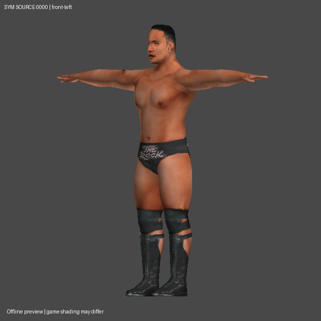

# SYM CH.PAC: original-source research checkpoint 2

This study uses the user's original `ch.pac`, identified by the user as
SmackDown! Shut Your Mouth (PS2). SHA-256:
`8e64f391179c38632a31a452845fc51c8efa53112b71cdba806136d89097955d`.
Size: **21,286,912 bytes**. Research branch: `research/sym-ch-pac-study`,
based on `4575004e13c95ec9b2ec3555de957f483eaddd94`.

**CONFIRMED** below means observed bytes, executed checks or inspected renders
from this sample. **INFERRED** identifies an interpretation that still needs
independent corroboration. **UNKNOWN** identifies an unanswered question.
User-supplied title provenance is not a title identifier embedded in the decoder.

The accepted converter, PSP writer, packaging, profiles, GUI and game assets
are unchanged. These research tools are not registered conversion adapters.

## Results

- **CONFIRMED:** the outer DPAC directory describes **140 costume entries**.
  All 140 computed entry starts contain valid inner PAC directories; cumulative
  sector allocations consume the file exactly. This is not a count of distinct
  wrestlers: different costumes/variants are present.
- **CONFIRMED:** there are **152 decompressed YOBJ objects**: 140 main section-2
  models and 12 additional objects. Existing HCTP geometry/weight contracts
  accept **151/152**, including **139/140 main models**. Successful parsing does
  not independently establish animation semantics.
- **CONFIRMED:** all **140 section-1 TIM2 atlases** pass the isolated decoder's
  bounds, dimension, CLUT, allocation and GS TEX0 checks. 135 are 1024×128/T8,
  four 1024×128/T4, one 256×256/T4. T8 uses 256 RGBA32 CLUT entries; T4 uses 16.
- **CONFIRMED:** seven contact sheets render all 139 accepted main models.
  Five views plus textured OBJ/MTL/PNG and full source-weight JSON are generated
  for IDs `0000`, `0001`, `0118`. Selected renders were inspected: Rock's tattoo,
  face, trunks and skin atlas align, and `0118` is a green mannequin.
- **INFERRED:** entry `0000` is The Rock, based on its visible likeness, trunks
  text and Brahma Bull imagery. No roster-name mapping is encoded by the tool.
- **CONFIRMED:** `0000` has 6 source meshes, 936 source position records,
  1,253 exported corner-split vertices and 1,490 nondegenerate strip triangles.
  UV/color seams account for the different vertex counts; no welding occurred.
- **CONFIRMED:** the 139 decoded main models collectively have 119,576 source
  vertices and 195,338 decoded nondegenerate triangles. The unsupported model
  is excluded from these totals. All decoded sections total 38,025,232 bytes.
- **UNKNOWN:** source-game animation correctness, PSP bone-controller mapping,
  complete material behavior and playable SYM conversion. No PSP PAC or game
  compatibility claim is produced by this study.

See [the machine-readable inventory](sym-ch-pac-inventory.json) for every
entry's original offsets, allocated sizes, hashes, section hashes, model counts,
texture metadata, active bone names and PSP name/parent comparisons. Full raw
field/bone/weight evidence is reproduced as `report.json` by the command below.



[Rock rear view](sym-ch-pac-study/rock-source-back.png) ·
Source contact sheets:
[1](sym-ch-pac-study/source-contact-01.jpg),
[2](sym-ch-pac-study/source-contact-02.jpg),
[3](sym-ch-pac-study/source-contact-03.jpg),
[4](sym-ch-pac-study/source-contact-04.jpg),
[5](sym-ch-pac-study/source-contact-05.jpg),
[6](sym-ch-pac-study/source-contact-06.jpg),
[7](sym-ch-pac-study/source-contact-07.jpg).

## Outer DPAC layout

**CONFIRMED for this sample only:** integers below are little-endian. The
read-only reader accepts this single `EMD ` group variant, not arbitrary DPACs.

| Absolute offset | Size | Observed field / interpretation | Evidence status |
|---|---:|---|---|
| `0x0000` | 4 | ASCII `DPAC` | CONFIRMED |
| `0x0004` | 4 | directory bytes `0x238` = 8 + 140×4 | CONFIRMED arithmetic |
| `0x0008` | 4 | payload bytes `0x1449000` = 21,270,528 | CONFIRMED arithmetic |
| `0x000c` | 4 | value 7 | CONFIRMED value; UNKNOWN meaning |
| `0x0010..0x07ff` | 2,032 | zero bytes | CONFIRMED |
| `0x0800` | 4 | ASCII `EMD ` | CONFIRMED |
| `0x0804` | 2 | `0x808c`: high flag `0x8000`, low 15 bits = 140 | CONFIRMED count; UNKNOWN flag meaning |
| `0x0806` | 2 | zero | CONFIRMED value; UNKNOWN meaning |
| `0x0808` | 140×4 | records: u16 ID, u16 size in 256-byte units | CONFIRMED by all 140 inner PACs |
| `0x0a38..0x3fff` | remaining gap | zero bytes | CONFIRMED |
| `0x4000` | payload area | first costume allocation | CONFIRMED |

**CONFIRMED extraction arithmetic:** payload start is
`file_length - u32(8)`, not a guess from the first `PAC ` signature. Entry
`i` has stored bytes `256 * size_units[i]`. Entry `i+1` starts after rounding
the previous entry's end **up to 2,048 bytes**. IDs are displayed as four hex
digits; they are not interpreted as wrestler numbers or character names.

**CONFIRMED:** all 140 alignment gaps contain a nonzero final four-byte word;
all preceding bytes in those gaps are zero. One word has only three nonzero
bytes. These words are **outside** the directory's 256-byte-unit PAC slices.
**UNKNOWN:** whether they are checksums, loader metadata or something else.
Ordinary `zlib.crc32` over the allocation excluding the last four bytes does
not match them. Do not regenerate, drop or zero them based on that failed
checksum hypothesis. `--extract` writes exact PAC slices AND allocation-gap
sidecars; it is not an outer archive rebuilder.

## Costume PAC sections

**CONFIRMED:** inner PACs use the existing `PAC ` + u32 count + 8-byte entry
contract: u16 section ID, u24 offset relative to table end, u24 stored size.
The existing inspector validates nonempty, disjoint ranges within the slice.
Observed section payloads expand through the existing bounded BPE decoder.
Stored section offsets in sample `0000` are four-byte aligned; do not infer
a universal section alignment rule from this example alone.

| Section | Observed decoded content | Status / unresolved role |
|---|---|---|
| 0 | `EMD ` and other bytes | CONFIRMED signature; UNKNOWN full metadata contract |
| 1 | one TIM2 body atlas | CONFIRMED by headers and textured main-model previews |
| 2 | main YOBJ | CONFIRMED geometry candidate, 139 accepted; 1 variant rejected |
| 3 | small binary block | UNKNOWN rendering/metadata semantics |
| 5 | extra YOBJ in 8 costumes; one bone each | CONFIRMED structure; UNKNOWN attachment/controller semantics |
| 6, 7 | extra YOBJs in `0000`/`0100` (68 triangles each) | CONFIRMED structure; INFERRED alternate accessory states, not extra body fragments |
| 10, 11 | named texture tables | CONFIRMED table structure; UNKNOWN full state/dependency mapping |

**CONFIRMED combinations:** 123 costumes have sections 0,1,2,3,10,11; eight
add section 5; two add sections 6/7; seven have only 0,1,2,3. Additional objects
are inventoried separately. No merging, accessory-role conversion or flattening
is attempted. In particular, section-5 texture dependencies must not be assumed
to be the main atlas merely because they use local texture index 0.

## Geometry and skinning contract probes

**CONFIRMED:** accepted YOBJs pass the existing readers unchanged:

- Common header: counts at +24/+28/+32, pointers at +36/+40/+44/+48;
  declared end = u32(+4)+8. Pointers use byte-8 origin.
- 64-byte mesh, 32-byte group, 80-byte bone, 208-byte material records.
- Group palettes contain one-based bone references. Position/normal vectors
  are float4. Material corners carry UVQ, source index and float RGBA.
- Corner UV/color differences split exported vertices while preserving the
  mesh-local `source_vertex_index` and each source influence record.
- Rigid groups have implicit weight 1; blended groups use the existing V4-32
  VIF decoder at fixed VU base `0x280`. The checked contracts include finite
  weights, valid palettes, exact record coverage, zero unused lanes and sums
  within `1e-5`. No normalization, fallback binding or weight permutation is
  used to make records pass.

These are **CONFIRMED structural agreements**, not independent proof that
every decoded lane/controller reproduces SYM animation. Detailed offsets are
documented in [the related-format comparison checklist](sym-conversion-research.md)
and [HCTP binary contracts](hctp-psp/binary-formats.md); the full generated
report includes mesh/group/material raw headers for this sample.

**CONFIRMED unsupported variant:** ID `0069`, section 2, is a 58,700-byte YOBJ
with 3 meshes, 124 bones and texture name `kage`. Its source vertex counts are
160,160,12; position/normal packet-count words are 321,321,25 (`2*n+1`).
The current HCTP contract requires `2*n+2`, so the reader rejects it. **UNKNOWN:**
what this variant represents and how its packets should be handled. No header
is patched and no synthetic preview is substituted for it.

## Bone/controller differences

**CONFIRMED:** 142 accepted objects have 124 bones, one has 125, eight have 1.
Entry `0000` uses 102 different bone names in nonzero source influences.
Compared with repository `creator_library/pacs/Chris-Benoit.PAC` (77 bones,
hash pinned in the inventory), only 43 names are shared. **59 actively used
source bone names are absent from that PSP skeleton**. Even among matching
names, 41 have different indices and 24 have different parents.

**CONFIRMED:** SYM includes `_w00`/`_w01`/`_w02` auxiliary bones, mouth controls
such as `c_sita_kuchi`, and hair chains; the PSP control uses other mouth,
eyelid, arm-helper and finger names/hierarchies. An archived HCTP Jericho QA
bone-name control shares 45 names with SYM Rock and differs at 24 shared-name
parents; its provenance and limits are in the supplementary evidence below. This is a
previous decoded QA artifact, not a fresh decode of a missing HCTP PAC.

The supplementary HCTP control is in
[hctp-control.json](sym-ch-pac-study/hctp-control.json), including its archive
hash and member path. Reproduce it with `zipfile.ZipFile`/`json.loads` on that
member and `tools.yobj_read.compare_skeletons(source_model, control)`. The main
inventory's `psp_name_comparison` records are generated by `--reference-psp`.

**INFERRED:** existing destination construction and QA can be reused after a
separate SYM source/profile adapter is validated. **UNKNOWN:** the correct
mapping for auxiliary deformation, finger directions, mouth/eye controllers,
bind-frame transforms and hair animation. Do not use shared numeric indices,
automatic ancestor collapse or the HCTP facial-controller policy as proof of
equivalence. Rest-pose likeness and normalized weights cannot validate this.

## TIM2 atlas decode and quality implications

**CONFIRMED header values:** TIM2 version 4, format/alignment byte 0, one picture.
Picture begins at absolute 16. Offsets below are relative to that picture;
integers are little-endian.

| Picture offset | Size | Meaning checked by isolated decoder |
|---|---:|---|
| +0 | 4 | total picture allocation |
| +4 | 4 | CLUT bytes (1,024 or 64) |
| +8 | 4 | image bytes (`width*height*bits/8`) |
| +12 | 2 | header bytes = 48 |
| +14 | 2 | declared CLUT entries = 256 or 16 |
| +16/+17 | 1 each | picture-format 0 / mipmap count 1 |
| +18/+19 | 1 each | CLUT type 3 / image type 5 (T8) or 4 (T4) |
| +20/+22 | 2 each | width/height |
| +24 | 8 | GS TEX0; PSM19/20, TW/TH match dimensions, CPSM/CSM/CSA all 0 |
| +32..+47 | 16 | retained bytes; full semantics UNKNOWN here |
| +48 | image bytes | pixel stream; CLUT immediately follows |

**CONFIRMED decoder behavior:** T8 indices are byte values; T4 uses low nibble
first. The CLUT consists of RGBA32 entries; T8 logical palette indices exchange
bits 3 and 4 for CSM1 ordering. There is no such exchange for the 16-entry CLUT.
The reader preserves RGB and converts PS2 alpha to preview alpha using
`min(255, raw_alpha*255//128)`. 60 palettes have alpha 128 throughout; 80 contain
both 0 and 128. It never applies the third-party plugin's low-alpha opacity fix.
**INFERRED:** linear pixel order plus this CLUT interpretation is correct for
the visually inspected source samples. **UNKNOWN:** exact blend/test/material
semantics and alpha effects in all source states. CPU previews are double-sided
and do not reproduce the full PS2 shader or accessory-state machine.

**CONFIRMED:** the source main YOBJ has one atlas texture slot; Rock calls the
whole atlas `rmomo`. That name does not mean the texture covers only a thigh.
The app's HCTP source path instead expects its observed named RTX3 collection.
Treating the atlas as one ordinary HCTP body-part texture would lose detail
and misclassify it.

**CONFIRMED:** 1024×128 is outside the current native-SVR-2011 GIM candidate
whitelist (`desktop/texture_optimizer/candidates.py`). Among its observed T8
dimension pairs, none retain the atlas's 8:1 aspect ratio; T4 includes 256×32
and 128×16. This is a conservative native-corpus convention, **not a claim
that generic PSP hardware universally forbids other dimensions**.
**INFERRED:** quality-conscious conversion should investigate atlas chart
partitioning/material remapping or a separately validated atlas policy; simply
shrinking the entire body atlas to 256×32/T4 could destroy facial/clothing detail.
Any partitioning must preserve sampled appearance at seams, wrapping and alpha
and be covered by source-reference QA. No atlas repartitioning is implemented.

## Reproduce, review and next integration gates

**CONFIRMED executed environment:** Python 3.12.14 with NumPy/Pillow and the
repository's pinned optional QA dependencies. No Noesis, uploaded executable,
Blender, game ISO or runtime conversion is needed for this read-only study.

```sh
python -m venv --system-site-packages local/sym-runtime
local/sym-runtime/bin/python -m pip install -r requirements-qa.txt
local/sym-runtime/bin/python -m unittest tests.test_sym_source tests.test_sym_research tests.test_hctp_read tests.test_hctp_weights tests.test_pac_inspect tests.test_ps2_textures
local/sym-runtime/bin/python -m tools.sym_ch_study /path/to/ch.pac --out local/NEW-study --previews --reference-psp creator_library/pacs/Chris-Benoit.PAC
```

**CONFIRMED:** 47 tests pass, including asset-free DPAC arithmetic/trailer
preservation, malformed ranges/counts, deterministic reporting, exact extraction,
refusal to overwrite, T4 nibble order, T8 CLUT permutation, alpha preservation,
TEX0/header mismatch rejection and the pre-existing source-reader controls.
To extract all costume slices add `--extract`; gap sidecars are not game PACs.
Raw source bytes are rechecked after the study. The compact inventory excludes
bulk bone records but records all entry/section hashes and model statistics;
`report.json` retains the full successful probe evidence. No supplied roster
archive, raw extracted model or source-weight dump is bundled in the application.

Generated `source.obj` uses original source axes, normals and UVs and references
`source.mtl`/`atlas.png`. Keep those three files together for Noesis. OBJ cannot
carry the rig, vertex colors or game shader; full records are in `model.json`.
Use the user's usual orientation/cull/shading toggles for comparison, with that
limitation in mind. The PNG renders are CPU source previews, not Noesis captures
and not PSP/in-game screenshots.

Next gates (**INFERRED plan**, not completed support):

1. Verify a small representative SYM source set independently, including an
   animated face, fingers, hair/accessory states and the exceptional packet type.
2. Build a separate source adapter carrying original mesh/vertex identities,
   palettes, controllers, atlas metadata and unknown section bytes.
3. Establish explicit rest-frame/controller mapping and atlas quality behavior;
   do not change destination packaging to accommodate source assumptions.
4. Compare bind and analytical poses against SYM reference surfaces, add QA
   regressions, then construct an isolated PSP candidate within configured
   serialized/memory constraints and test it in PPSSPP before enabling support.
