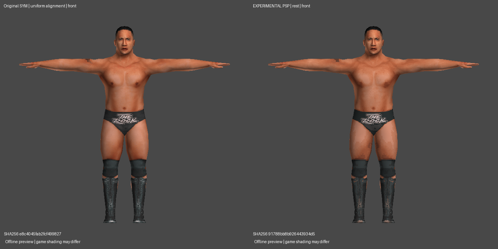
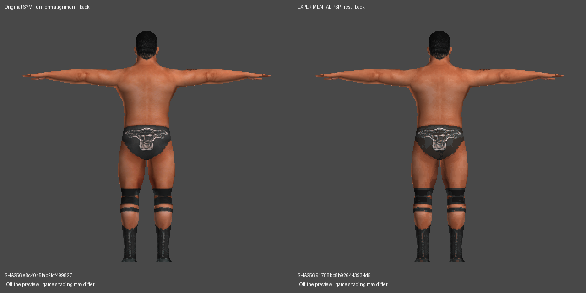
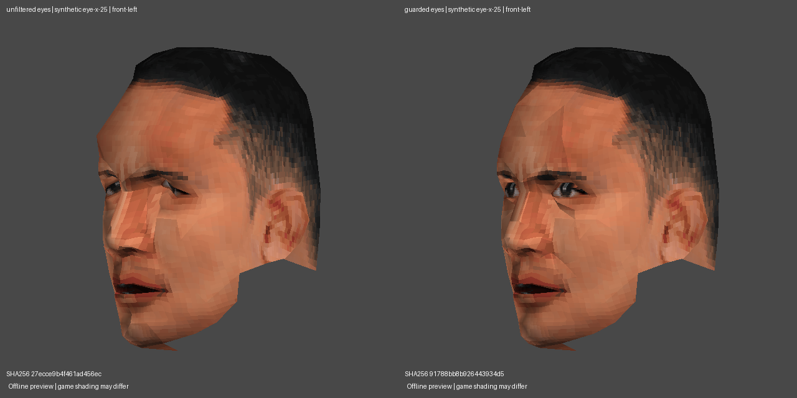

# SYM → PSP: first isolated main-model trial

This work is isolated on `experiment/sym-adapter-trials`, based on research
commit `33418860c43e448d18208719bf6cab309102c0c9`. No converter, GUI, HCTP
profile, PSP writer, packaging implementation or accepted PAC was modified.
The desktop SYM adapter remains disabled.

**CONFIRMED** means executed byte/geometry checks, inspected CPU renders or
tests. **INFERRED** identifies an interpretation or mapping hypothesis.
**UNKNOWN** marks unverified runtime/animation behavior. Structural acceptance
and synthetic animation do not establish actual SVR 2011 compatibility.

## Download and scope

[Experimental Rock PAC, native YOBJ, Noesis OBJ/PNG preview and QA bundle](../downloads/SYM-Rock-first-PSP-trial.zip)

**CONFIRMED:** the bundle's `SYM-0000-main-only-EXPERIMENTAL.pac` contains the
model that produced its candidate renders. The final PAC was unpacked again;
its YOBJ and GIM payloads were compared with the audited/rendered payloads.
Render labels include the PAC hash prefix. Source and negative-control images
have their own labels/fingerprints and are not screenshots of the candidate.

```text
PAC bytes: 118,784 (116 KiB), within configured 148,000-byte target
PAC SHA256:
91788bb8b926443934d50424bd54f6164c929ccdca60926802fa64298ad80173
Native YOBJ SHA256:
df70f9074d7d1e93966ff304361dab4a87c3163d5fc4b26c46f82a0c4817c613
```

**CONFIRMED measurements:**

| Item | Original SYM Rock | Experimental PSP |
|---|---:|---:|
| Costume PAC bytes, excluding outer archive sector gap | 170,240 | 118,784 |
| Native YOBJ bytes | 141,228 | 139,552 |
| Position records / stored vertices | 936 source positions; 1,253 UV/color corner records | 1,505 draw-buffer vertices |
| Triangles | 1,490 | 1,490 |
| Mesh buffers | 6 | 50 |
| Material/draw records | 6 | 97 |
| Texture slots | 1 atlas | 22 chart textures |
| Skeleton | 124-bone SYM | unchanged 77-bone PSP Kurt base |

**CONFIRMED:** no decimation, reshaping, region displacement, pose warping or
nonuniform scale was applied. Only the existing uniform landmark alignment and
float32 storage affect positions. Different vertex/mesh counts come from UV
charts and PSP part/palette draw buffers, including required duplicates; they
do not represent lost triangles. No arbitrary mesh count was targeted. Only
the existing packer's byte-identical compatible vertex deduplication is used.

**CONFIRMED:** this is **main-model only**. Source YOBJs in sections 6 and 7
are inventoried by hash but are not assigned guessed PSP accessory states.
Blood-overlay conversion is not included. Unrelated PSP base sections and its
bone table remain byte-identical. The user-supplied source archive remains
byte-identical. The complete original archive is not distributed in the bundle.

**UNKNOWN:** behavior of those omitted costume states, actual SVR animation
semantics, runtime culling/memory, and gameplay stability. One two-slot skinned
left-leg buffer remains an explicit native-layout review finding. Existing
one-slot compatibility rules were checked; they made no changes. Do not infer
a universal three-slot requirement or pad other layouts without evidence.

## Source comparison renders

**CONFIRMED:** these are CPU renders, not Noesis captures or PPSSPP screenshots.
Reference and candidate share view/light/projection settings and a common
camera frame. That frame is view-only and is absent from PAC/YOBJ/OBJ exports.





[Side comparison](sym-first-psp-trial/comparison-left.png) ·
[Three-quarter comparison](sym-first-psp-trial/comparison-front-left.png).

## Discovery: bone-bound fields are not joint origins

**CONFIRMED:** across 139 decoded main models, all **15,190 active bones** have
their influenced vertices (weights above `1e-7`) enclosed by the float4 at bone-record
`+64` interpreted as `(center_x, center_y, center_z, radius)`, within `1e-4`.
For Rock, 102/102 active bones pass. The local-chain joint origins and these
centers can differ substantially; empty helper records can contain zero spheres.

**INFERRED:** this is influence-bound information. **UNKNOWN:** how SYM uses
it for culling, collision or other runtime purposes. The older generic reader's
`stored_global_position` API name must not be interpreted as a verified joint
origin. Existing alignment already uses the local translation/rotation hierarchy;
this discovery did not require changing accepted HCTP alignment or geometry.
The old API name is retained for compatibility; new diagnostics explain it.

## Lossless source atlas adaptation

**CONFIRMED:** equal-width cuts are unsafe. Rock has 91 triangles crossing
nominal 128-pixel column boundaries. Its actual UV islands have irregular
origins/widths; they are not eight equal textures.

**CONFIRMED implemented algorithm (`tools/sym_atlas.py`):**

1. Join triangles across exact, nonzero-length shared UV edges.
2. Compute each island's full bilinear texel footprint using `uv*size - 0.5`.
3. Copy original atlas samples into a source-bounded canvas compatible with
   observed native GIM dimension conventions. Prefer a full T8-compatible box;
   wider canvases may require subsequent T4 or resolution fitting.
4. Preserve full-axis repeat behavior and atlas-edge wrapping. Padding is
   original neighboring atlas context; no pixels are upscaled or invented.
5. Transform per-corner UVs into the crop's coordinate system, duplicating
   corner records where needed. Do not clip/subdivide triangles or move vertices.
6. Compare original/cropped repeating bilinear RGBA at nine barycentric samples
   per triangle, covering corners, edges and interiors.

**CONFIRMED:** all **139 decoded main models** pass this lossless source-stage
comparison. Maximum sampled RGBA error across them is `4.67e-11` on 0–255
channels. Rock produces 22 charts. This result is not 139 successful PSP PACs:
only Rock went through the destination builder and texture budgeting here.
The special `0069` packet variant remains rejected before geometry decoding.

**CONFIRMED rejected first approach:** requiring every full-resolution crop to
fit T8 immediately accepted only 104/139 decoded models. The other 35 included
legitimate full-axis wrapping (e.g. a 129-texel interval on a repeating 128-row
atlas) and 144–221-pixel-wide islands. Preserving the source-axis period and
allowing wider source canvases resolves the lossless source stage; later GIM
encoding must still obey its actual bit-depth/dimension whitelist.

**CONFIRMED:** source crop pixels/alpha are exact before quality fitting.
Subsequent PSP palette/resolution choices are lossy and are reported separately;
lossless chart adaptation must not be confused with lossless final textures.
Wider source canvases do not imply unobserved T8 dimensions can be serialized.

## Rig trial and eye QA refinement

**INFERRED mapping hypothesis:** retain contributions on shared major body
chains, and use barycentric PSP donor weights for SYM-only helpers/controllers.
Fingers and facial controls are excluded from blind same-name mapping. This
uses the original PSP skeleton and transforms; it does not copy SYM skeleton
records into a PSP file. The source records remain available for diagnostics.
The ancestor-only mapping is a separate, labeled negative/control experiment.

**CONFIRMED failure found before release:** unconstrained nearest-surface
transfer assigned native eyeball weights outside original SYM eyeball support.
There were **25 eyeball spill records**. A broader initial count of 32 included
seven eyelid records; those must not be mistaken for eyeball spill.
The unfiltered trial triggered four synthetic ocular-envelope warnings.

**CONFIRMED correction implemented as an isolated hypothesis:**

- Use source `l_eye`/`r_eye` support to identify rigid eyeball geometry. This
  source has eight eye corner records with rigid, nonoverlapping support.
- Map that geometry to the corresponding native eyeball role. Redirect leaked
  eyeball mass on surrounding skin to the native head anchor.
- Retain donor eyelid/brow weights and preserve jaw coefficients exactly.
- Reject nonrigid/overlapping eye support or eye/jaw conflicts as outside this
  validated experiment; do not silently force those sources into this rule.

**CONFIRMED:** 29 records change from the unfiltered weighting trial: 25 spill
records and four previously mismapped eye records. Rest positions, UVs, textures
and triangle geometry are unchanged. Jaw coefficient delta is exactly 0.
Maximum change under 14 body/jaw poses is `2.67e-15` native units. All four
ocular-envelope warnings clear. These are synthetic improvements, not evidence
that SYM and PSP eye animation semantics are universally interchangeable.



| Synthetic probe | Unfiltered max motion | Guarded max motion | Native donor max motion |
|---|---:|---:|---:|
| Eyes, world X +25° | 0.154165 | 0.117407 | 0.072245 |
| Eyes, world Z +25° | 0.158106 | 0.108216 | 0.073887 |

**CONFIRMED diagnostic threshold:** flag motion above
`1.5 * donor_max_motion + 0.002 * reference_height`. **INFERRED:** this is a
useful provisional review envelope. It is not an established game limit or a
claim that every difference from the donor is an error. The CLI withholds a
PAC on an ocular-envelope or newly collapsed-triangle finding; unrelated native
layout findings remain visible for human review.

## Texture fitting and rejected configuration

**CONFIRMED:** the initial all-T8 configuration reached 129,024 PAC bytes but
69,056 modeled pixel/CLUT bytes against the selected PSP base's **54,016-byte**
allocation envelope. It was rejected for allocation, not file size.

**UNKNOWN:** actual SVR heap limit. **CONFIRMED:** that base envelope is a
conservative experiment choice, not a universal maximum. The prior native
corpus study observed up to 87,872 modeled bytes across its sample set; title,
costume state, loader and match context still need controlled validation before
using larger allocations for this trial.

**CONFIRMED final experiment:** T8 for majority-cranial/cutout charts and T4
for other charts, using the unchanged source-bounded candidate encoder and
actual-PAC allocator. This is a fixed-format comparison profile, not the final
general-purpose texture policy. Cranial floors are source-bounded; true alpha
cutouts must retain exact samples. The final Rock atlas is opaque.

- Total modeled pixel/CLUT bytes including retained base resources: **53,440**.
- Native base reference allocation: **54,016**; 576 modeled bytes remain.
- Encoded GIM files for the changed model: **51,680 bytes**.
- Stored BPE model / changed texture table: **75,149 / 36,221 bytes**.
- Actual combinations measured: **514**.
- PAC: **118,784 bytes**, with 29,216 bytes of file-cap headroom. That does not
  create more room under the separate conservative allocation envelope.

**CONFIRMED:** 16 charts use T4 and six use T8. The dominant cranial chart is
64×64/T8 with 233 used colors. Quality tradeoffs are visible in the comparison
renders and listed per chart in the bundle's `textures/report.json`. The result
does not claim maximum achievable PSP texture fidelity.

## Validation and reproduction

**CONFIRMED:** native auditing checks allocations, pointers, POF0 relocations,
vertex/index buffer alignment/ranges, palette indices, finite normalized weights,
material/GIM consistency, base bone bytes and unrelated base sections. The
candidate contains the exact audited/rendered YOBJ and textures. Rebuilding
using the unchanged `package_models` path reproduces the PAC bytes exactly.

**CONFIRMED:** area-weighted bidirectional source-surface comparison uses 4,000
samples each way, plus every candidate vertex and regional depth/curvature
diagnostics. Differences are consistent with float32 storage. No vertex-index
correspondence is assumed for that surface comparison.

**CONFIRMED:** 15 body/rest poses and 16 ocular probes verify intended-vs-native
LBS replay, exact effective attribute/weight correspondence, preserved equivalent
seams, finite positions and no newly collapsed triangles. These checks establish
serialization consistency; original SYM animation clips were not available.
Shared camera source/candidate images cover front, rear, sides and three-quarter
views. Head close-ups expose the unfiltered/guarded eye behavior.

```sh
local/sym-runtime/bin/python -m tools.sym_adapter_survey /path/to/ch.pac --out local/NEW-survey.json
local/sym-runtime/bin/python -m tools.sym_trial /path/to/ch.pac --base /path/to/OWN-PSP-base.pac --entry 0000 --out local/NEW-Rock-trial
```

**CONFIRMED:** 136 tests pass across the SYM readers/adapter trials, HCTP
readers, original source-skinning identity, native writer, one-slot compatibility,
BPE, PAC repacking and existing adaptive textures. Tests include wrapped/border
UVs, wide crops, transparency, exact source attributes, malformed layouts,
determinism, nonrigid-eye review and preservation of jaw/lid weights. Source
fixtures are synthetic; no new proprietary runtime dependency is introduced.

Use `requirements-qa.txt` and the research setup documented in
[checkpoint 2](sym-ch-pac-study.md). The previously pinned Kurt base can be
restored locally from the repository's historical beta archive for regression
tests; the test base is not a substitute for users selecting their own base.

```sh
local/sym-runtime/bin/python -m unittest tests.test_sym_adapter_trials tests.test_sym_source tests.test_sym_research tests.test_hctp_read tests.test_hctp_weights tests.test_pac_inspect tests.test_ps2_textures tests.test_portable_desktop tests.test_portable_skinning tests.test_source_skinning_identity tests.test_adaptive_textures tests.test_yukes_bpe tests.test_textures_and_repack
```

Machine-readable evidence:
[corpus survey](sym-first-psp-trial/corpus-survey.json),
[final candidate QA](sym-first-psp-trial/report.json),
[eye refinement/control QA](sym-first-psp-trial/ocular-refinement.json),
[rig decisions](sym-first-psp-trial/rig.json),
[texture budget](sym-first-psp-trial/texture-budget.json).

## PPSSPP trial

Open `preview/model.obj` in Noesis with `preview.mtl` and its PNG files together.
OBJ is the decoded final rest geometry with a documented axis rotation; it does
not contain the PSP rig. `prepared.yobj` and the PAC contain the native rig.

Inject the experimental PAC into a backed-up SVR 2011 PSP wrestler costume
slot using the user's proven PAC/ARC/ISO workflow. The SYM ID `0000` is not a
PSP destination-slot instruction. Check standing, arms, knees, walking/bending,
eye gaze/blinks, jaw, entrance and victory transitions. Test the incomplete
accessory/blood states separately; do not replace an accepted baseline with this
trial merely because it passed structural checks.

**UNKNOWN / next gates:** actual PPSSPP behavior; nonrigid source-eye mappings;
source accessory-state and alpha/shader semantics; the exceptional model packet;
runtime allocation/culling and higher-fidelity atlas policies. Production SYM
support requires those checks and representative additional conversions.
